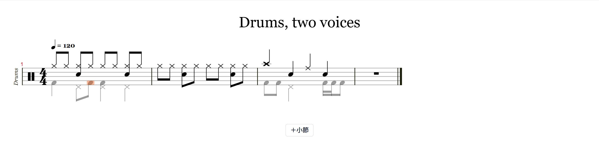
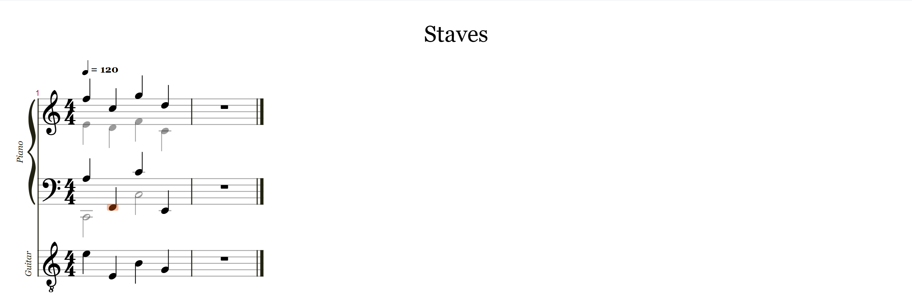
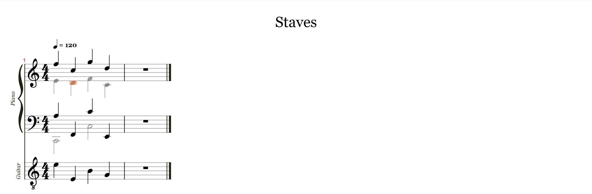
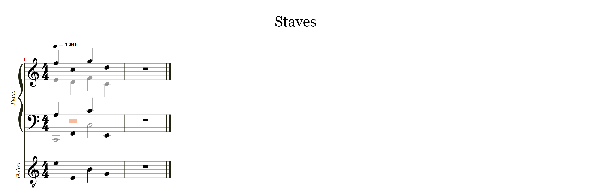

# 量測報告

每個里程碑結尾的重測（[`spec/testing.md`](spec/testing.md) 第 4 節）。M0 的結果在 [`spike-report.md`](spike-report.md)。門檻只是目標，不是 CI 的關卡；量測不在 CI 裡跑。

## M1b

日期：2026-11-18　分支：`hiad-20261116/39-s2-remeasure`（以 `hiad-20261116/studio` `8bce07b` 為底，含 M1b 的全部改動）　票：#39

### 結論

| 項目 | 結果 |
|---|---|
| 門檻 | 按鍵到畫面 p95：一個聲部 ≤ 80 ms、五個聲部 ≤ 150 ms（100 小節 × 5 聲部） |
| Chromium | **達標**。一個聲部最差 61 ms、五個聲部最差 86 ms；另一位成員同時修改時 54 / 89 ms |
| Firefox | **沒達標**（以保守的算法）。一個聲部最差 93 ms（差 13）、五個聲部有技巧的第 3 小節 158 ms（差 8）；同時修改時 96 / 169 ms。改用第一個 frame 算則全部達標（≤ 75 / ≤ 146 ms）。headless Firefox 的 frame 間隔是 31 ms，見「怎麼讀」 |
| WebKit | **沒達標**（以保守的算法），而且數字不完全可信。一個聲部有技巧時最差 88 ms（差 8）、五個聲部 108 ms；同時修改時 90 / 169 ms。Windows 的 Playwright WebKit 沒有 Web Audio（#129），量的是沒有播放器的頁面 |
| `readScore`（zod 驗證 + `WeakMap` 快取） | Chromium 中位數 1.7–2.1 ms，和 M0 的 `docToJson`（1.8 ms）相同；p95 6–8 ms，比 M0（2–3 ms）長 |
| 技巧與 Flag 全部重算 | **不是瓶頸**。`flagsOf` 對整份譜（有技巧的譜 324 個 Flag）Chromium 中位數 0.8–1.2 ms、p95 ≤ 4.5 ms，Firefox / WebKit 中位數 1–3 ms；約占按鍵到畫面的 5% 以內。技巧讓排版變慢（五個聲部第 3 小節 27 → 37 ms），不是 Flag。不建議另開「Flag 改成增量」的票 |
| 時間花在哪 | alphaTab 的排版（`render → rendered`），在 Firefox 約是 Chromium 的 2 倍；以及瀏覽器把畫面送出來的 frame 時序 |

### 環境

| 項目 | 內容 |
|---|---|
| 機器 | Intel Core i9-9900K（8 核 16 緒，3.6 GHz）、128 GB RAM、AMD Radeon RX 9060 XT。桌機，比樂團成員的筆電快 |
| 作業系統 | Windows 11 Pro 10.0.26200（x64） |
| 瀏覽器 | Playwright 1.65.0 附的瀏覽器，全部 headless：Chromium 158.0.8127.18（chrome-headless-shell）、Firefox 159.0（firefox-1572）、WebKit 27.2（webkit-2388）。視窗 1280 × 720，DPR 1（WebKit 也設成 1，不是 Mac 的 2） |
| 計時精度 | `performance.now()` 的最小間隔：Chromium 0.1 ms，Firefox 與 WebKit 1 ms。Firefox / WebKit 的各階段數字因此是整數毫秒，1 ms 以下的階段只能看出「不到 1 ms」 |
| Web Audio | Chromium、Firefox 有；WebKit 沒有（#129） |
| 版本 | Node 24.10.0、pnpm 10.19.0、TypeScript 6.0.3、Vite 8.3.8、Vue 3.5.45、Yjs 13.6.33、Hocuspocus 4.8.0、alphaTab 1.9.0 |
| 量測對象 | 打包後的網頁（`VITE_MEASURE=1` 的 `vite build`），Chromium 與 Firefox 由 `vite preview`（5183）提供，WebKit 由第三個 server 提供（8033，`INSECURE_COOKIES=1`）；server、Postgres、Redis 與 e2e 相同 |
| 負載 | 量測時沒有跑其他重的工作（沒有建置、測試或其他瀏覽器自動化）；桌面上的一般程式還開著。CPU 使用率每分鐘取樣一次，含量測本身在 3–33% 之間 |

三個瀏覽器在同一次執行裡依序量（共 28.8 分鐘）。

### 指令

```
# 全部三個瀏覽器的 S2（結果寫到 docs/measurements/data/）
pnpm --filter @studio/web measure --project=chromium --project=firefox --project=webkit latency

# 只量一個瀏覽器
pnpm --filter @studio/web measure --project=firefox latency

# 開視窗跑（headed）；MEASURE_RUNS=3 只確認套件能跑
HEADED=1 pnpm --filter @studio/web measure --project=firefox latency
MEASURE_RUNS=3 pnpm --filter @studio/web measure --project=webkit latency
```

`--project` 選瀏覽器；`chromium` 跑全部量測，`firefox` 與 `webkit` 只跑 S2（`latency.spec.ts`）。需要 5183、8031、8032、8033 這幾個 port 空著，Postgres 與 Redis 照 e2e 的設定（127.0.0.1:5438 / 6388）。

### 做法

和 M0 的 S2 相同的部分：100 小節 × 5 聲部（Guitar 1、Drums、Keys、Bass、Guitar 2），每小節 8 個八分音符，共 4,000 個拍點；修改 Guitar 1 第 3、50、98 小節第一個拍點的格號；「一個聲部」是成員自己的顯示選項只顯示 Guitar 1。每格 50 次，報中位數與 p95（p95 取第 48 小的值）。編輯視圖用 M0 選的做法（就地換小節、`firstChangedMasterBar`、不用 worker）。

這次的不同：

1. **量的是編輯視圖**（#37），以 admin 登入、開著播放器，和成員實際使用相同。
2. **兩份譜**：`plain` 是 M0 那份；`techniques` 是同樣的音符加上 M1b 的技巧——搥勾弦、滑音（shift、inBelow）、推弦加顫音、點弦、泛音、ghost、staccato、accent、let ring、palm mute、dead、刷弦、slap / pop、每小節開頭的力度、每四小節一個和弦名稱，Keys 每小節一個 tie。其中一部分搥勾弦、滑音與 tie 接不到下一個音，整份譜有 324 個 Flag（`danglingLink`、`danglingTie`）。
3. **各階段多了 `flagsOf`**：`readScore`（讀文件、zod 驗證、`WeakMap` 快取已驗證的拍點）之後，頁面對**整份譜**重算 Flag，這段時間單獨記錄（`RenderSample.flags`；它也包含之前把資料交給頁面的 `score.value = json`，一個 shallow ref 的指定）。
4. **另一位成員同時修改**：同一個瀏覽器的另一個 context 以 Editor 帳號開同一份譜（只顯示 Guitar 1），每 250 ms 改一次 Guitar 1 某個小節第一個拍點的格號（小節隨機，避開正在打字的那一小節），實際約每秒 3.6–3.7 次。打字的頁面在每格 50 個按鍵期間收到並畫了 138–152 次（自己的按鍵加對方的修改）。另一個客戶端和打字的頁面在同一台機器上，它自己的排版也占 CPU，所以這是偏悲觀的情況。
5. **按鍵到畫面**：Playwright 送出真的按鍵，間隔 150–650 ms 變動；記錄事件的 `timeStamp`、指令做完、rendered、游標所在小節那一塊畫上去，以及之後第一、第二個 animation frame。和 M0 一樣以**第二個 frame**（frame after）和門檻比較，這比實際多算最多一個 frame。按鍵樣本先依按下的時間排序再去掉前 3 個暖身（#37 審查留下的修正）。

### 數字：按鍵到畫面

毫秒，中位數 / p95，取第二個 frame（frame after）。粗體是超過門檻的 p95。

| 瀏覽器 | 情境 | 顯示 | 第 3 小節 | 第 50 小節 | 第 98 小節 |
|---|---|---|---|---|---|
| Chromium | plain | 1 個聲部 | 39 / 53 | 38 / 53 | 39 / 50 |
| Chromium | plain | 5 個聲部 | 56 / 77 | 44 / 68 | 35 / 55 |
| Chromium | techniques | 1 個聲部 | 41 / 61 | 38 / 59 | 38 / 52 |
| Chromium | techniques | 5 個聲部 | 72 / 86 | 58 / 74 | 38 / 56 |
| Chromium | 同時修改（plain） | 1 個聲部 | 40 / 54 | 36 / 52 | 31 / 53 |
| Chromium | 同時修改（plain） | 5 個聲部 | 65 / 89 | 52 / 79 | 40 / 62 |
| Firefox | plain | 1 個聲部 | 63 / **92** | 61 / 79 | 61 / 78 |
| Firefox | plain | 5 個聲部 | 117 / 139 | 88 / 107 | 62 / 83 |
| Firefox | techniques | 1 個聲部 | 63 / **93** | 62 / **93** | 60 / 78 |
| Firefox | techniques | 5 個聲部 | 135 / **158** | 94 / 123 | 63 / 92 |
| Firefox | 同時修改（plain） | 1 個聲部 | 63 / **92** | 61 / **96** | 62 / **93** |
| Firefox | 同時修改（plain） | 5 個聲部 | 124 / **169** | 89 / **151** | 63 / 114 |
| WebKit | plain | 1 個聲部 | 62 / 76 | 60 / 65 | 54 / 76 |
| WebKit | plain | 5 個聲部 | 92 / 108 | 90 / 108 | 77 / 106 |
| WebKit | techniques | 1 個聲部 | 62 / **83** | 62 / **88** | 61 / 77 |
| WebKit | techniques | 5 個聲部 | 93 / 108 | 78 / 105 | 67 / 92 |
| WebKit | 同時修改（plain） | 1 個聲部 | 62 / **90** | 62 / 77 | 60 / 77 |
| WebKit | 同時修改（plain） | 5 個聲部 | 100 / **151** | 108 / **169** | 94 / 139 |

每一格的 50 個按鍵都等到了重畫，沒有丟掉任何樣本。完整的表（handler 開始、指令做完、rendered、小節畫上去、第一個 frame）在 [`m1b-s2-keys-*-headless.md`](measurements/data/) 與 [`m1b-s2-concurrent-*-headless.md`](measurements/data/)。

**和門檻比較**（p95 的最差值，取第二個 frame；括號內是取第一個 frame）

| 瀏覽器 | 一個聲部（≤ 80） | 五個聲部（≤ 150） | 同時修改：一個 / 五個聲部 |
|---|---|---|---|
| Chromium | 61（45）達標 | 86（69）達標 | 54（40）/ 89（74）達標 |
| Firefox | 93（75）沒達標 | 158（128）沒達標 | 96（62）/ 169（146）沒達標 |
| WebKit（無播放器） | 88（63）沒達標 | 108（93）達標 | 90（70）/ 169（122）沒達標 |

### 數字：各階段

毫秒，中位數 / p95，每次修改之間停 120 ms。Chromium（0.1 ms 精度）：

| 譜 | 顯示 | 小節 | `readScore` | `flagsOf` | 投影 | `finish()` | 排版到 rendered | 合計 |
|---|---|---|---|---|---|---|---|---|
| plain | 1 | 3 | 1.8 / 6.8 | 0.8 / 2.6 | 0.2 / 0.6 | 0.0 / 0.1 | 4.5 / 9.9 | 7.4 / 19.8 |
| plain | 1 | 50 | 1.7 / 6.8 | 0.8 / 2.6 | 0.2 / 0.5 | 0.0 / 0.1 | 2.1 / 5.6 | 5.0 / 15.6 |
| plain | 1 | 98 | 1.9 / 7.7 | 0.8 / 2.8 | 0.2 / 0.6 | 0.0 / 0.1 | 0.6 / 1.5 | 3.4 / 12.9 |
| plain | 5 | 3 | 1.8 / 7.5 | 0.8 / 2.8 | 0.2 / 0.5 | 0.0 / 0.1 | 27.0 / 41.8 | 30.1 / 50.2 |
| plain | 5 | 50 | 1.7 / 7.6 | 0.8 / 2.6 | 0.2 / 0.6 | 0.0 / 0.1 | 12.5 / 21.4 | 15.0 / 30.8 |
| plain | 5 | 98 | 1.7 / 6.6 | 0.8 / 2.3 | 0.2 / 0.5 | 0.0 / 0.1 | 1.6 / 3.7 | 4.3 / 13.2 |
| techniques | 1 | 3 | 1.8 / 7.4 | 1.2 / 4.0 | 0.2 / 0.6 | 0.0 / 0.1 | 7.1 / 14.5 | 10.8 / 27.5 |
| techniques | 1 | 50 | 1.7 / 6.5 | 1.2 / 3.6 | 0.3 / 0.7 | 0.0 / 0.2 | 3.6 / 8.5 | 7.2 / 19.7 |
| techniques | 1 | 98 | 1.8 / 7.5 | 1.2 / 4.0 | 0.2 / 0.5 | 0.0 / 0.1 | 0.7 / 1.6 | 4.4 / 15.0 |
| techniques | 5 | 3 | 2.1 / 7.6 | 1.2 / 4.5 | 0.3 / 0.6 | 0.0 / 0.2 | 36.8 / 49.4 | 41.0 / 62.1 |
| techniques | 5 | 50 | 1.8 / 6.8 | 1.2 / 3.6 | 0.2 / 0.6 | 0.0 / 0.1 | 16.2 / 29.5 | 20.4 / 39.8 |
| techniques | 5 | 98 | 1.8 / 6.3 | 1.1 / 3.5 | 0.2 / 0.5 | 0.0 / 0.1 | 2.0 / 4.5 | 6.0 / 15.1 |

Firefox 與 WebKit 摘要（1 ms 精度，全部 12 格的範圍）：

| 瀏覽器 | `readScore` 中位數 / p95 | `flagsOf` 中位數 / p95 | 排版到 rendered：五個聲部第 3 小節（plain / techniques） | 合計最差 p95 |
|---|---|---|---|---|
| Firefox | 2–3 / 6–10 | 2–3 / 3–12 | 57 / 71、80 / 94 | 109 |
| WebKit | 3 / 6–9 | 1–2 / 3–6 | 23 / 35、32 / 41 | 55 |

完整的表在 [`m1b-s2-stages-*-headless.md`](measurements/data/)。

### 怎麼讀這些數字

- **`docToJson` 加 zod 驗證與 `WeakMap` 快取**（現在是 `readScore`）：中位數和 M0 沒有驗證時的 `docToJson` 一樣（1.8 ms），快取讓每次修改只重新驗證改到的那一小節。Chromium 的 p95 是 6.3–7.7 ms，M0 是 2.1–3.4 ms；Firefox 與 WebKit 是 6–10 ms，但這兩個瀏覽器沒有 M0 的基準可比。兩次的條件不同：M0 在鷹架頁量、各階段不開播放器，這次在編輯視圖量、開著播放器，頁面上還有游標、presence 與 Flag 的畫面要更新。所以 p95 變長的可能原因包括條件不同、回收記憶體，以及快取失效的那幾次，這次沒有追。和門檻比起來不大。
- **Flag 全部重算不是瓶頸**：每次修改都對整份譜重算 Flag，Chromium 0.8 ms（沒有 Flag）到 1.2 ms（324 個 Flag），p95 ≤ 4.5 ms；Firefox 與 WebKit 中位數 1–3 ms。按鍵到畫面的中位數是 31–135 ms，`flagsOf` 約占 5% 以內。
  - 超過門檻最少的三格：Firefox 同時修改五個聲部第 50 小節 151 ms、WebKit 同時修改五個聲部第 3 小節 151 ms（都只差 1 ms），以及 WebKit 技巧譜一個聲部第 3 小節 83 ms（差 3 ms）。這三格的 `flagsOf` 中位數都是 2 ms；同時修改的兩格沒有自己的各階段資料，用的是同一瀏覽器、同一格 plain 譜的各階段數字。差 1–3 ms 在這次量測的雜訊範圍內：計時精度是 1 ms，而 p95 是 50 個樣本中第 48 小的值，多一兩個慢的樣本就會讓它移動好幾 ms。`flagsOf` 降到 0 可能讓這三格跨進門檻，但不改變各瀏覽器的整體判定。
  - 其他沒達標的格子都超過 8 ms 以上，遠大於 `flagsOf` 的 1–3 ms：Firefox 一個聲部最差 93 ms（差 13）、五個聲部技巧譜第 3 小節 158 ms（差 8）、同時修改一個聲部第 50 小節 96 ms（差 16）、同時修改五個聲部第 3 小節 169 ms（差 19）；WebKit 一個聲部技巧譜第 50 小節 88 ms（差 8）、同時修改一個聲部第 3 小節 90 ms（差 10）、同時修改五個聲部第 50 小節 169 ms（差 19）。就算 Flag 不花時間，Firefox 與 WebKit 也仍然沒達標，Chromium 本來就達標。
  - 依 `spec/testing.md`「只有證明是瓶頸時，才把 Flag 改成增量計算」，**不開**改成增量的票。
- **技巧的成本在排版**：同樣的修改，技巧譜比 plain 譜的排版多 30–60%（Chromium 五個聲部第 3 小節 27.0 → 36.8 ms，Firefox 57 → 80 ms）；投影只多 0.1 ms。
- **另一位成員同時修改**：在 Chromium 讓 p95 多 0–12 ms（五個聲部第 3 小節 77 → 89 ms），仍在門檻內；在 Firefox 與 WebKit 讓五個聲部的 p95 多 30–60 ms（Firefox 第 3 小節 139 → 169 ms、WebKit 第 50 小節 108 → 169 ms）。原因是按鍵碰上剛開始的對方修改的排版，要等它做完；五個聲部時「handler 開始」的 p95 從 1 ms 變成 10–25 ms（Chromium / WebKit）就是這件事。對方的客戶端也在同一台機器上排版，會比真實情況更糟。
- **瀏覽器的 frame 時序占了很大一塊**：
  - headless Firefox 的 animation frame 間隔中位數是 **31 ms**（約 32 Hz），不是 60 Hz 的 16.7 ms。以第二個 frame 算時，等兩個 frame 就固定多出 30–60 ms；Firefox 的 frame after 中位數幾乎都落在 61–63 ms 也是這個原因。開視窗的 Firefox 在 60 Hz 螢幕上很可能會好上一截，但**這次沒有量**。
  - WebKit（Windows 的 Playwright 版本）在小節畫上去之後，第一個 frame 要再等中位數 **28 ms**（Chromium 5 ms、Firefox 8 ms），frame 間隔則是 16 ms。這比較像 Windows 版 WebKit 的繪製排程，不一定代表 Mac 上的 Safari。
- **Firefox 的排版約是 Chromium 的 2 倍**（五個聲部第 3 小節 57 vs 27 ms，技巧譜 80 vs 37 ms），這部分和 frame 時序無關。如果開視窗量之後 Firefox 仍然沒達標，第一個要動的就是這裡：M0 報告提過的「只畫游標附近的小節」。
- **WebKit 的數字只能當參考**：
  - 頁面沒有 Web Audio，alphaTab 的播放器永遠不會 ready，修改後 400 ms 重新產生聲音的那一步（`player.load()`）什麼都不做，所以 WebKit 少了 Chromium / Firefox 有的那份負擔（M0 量過是 9–15 ms，在按鍵之間發生）。
  - 這是 Windows 上的 WebKit，不是 macOS 的 Safari：圖形後端、frame 排程與 JIT 設定都不同，`navigator.hardwareConcurrency` 只回報 8。
  - DPR 設成 1；Mac 的 Retina 螢幕是 2，繪製量是四倍，這次沒有量。
- **和 M0 比較（Chromium）**：M0 的 `replace+hint, no worker` 一個聲部 p95 41–44 ms、五個聲部 39–67 ms；這次 plain 譜 50–53 / 55–77 ms。同一小節相比多了 6–16 ms，來自編輯視圖本身（`readScore` 的 p95、`flagsOf`、游標與 presence 的重畫、播放器），和 M0 用的鷹架頁不同；排版本身（27.0 vs 27.3 ms）沒有變。

### 需要人做的事

- 在 60 Hz（或更高）的螢幕上開視窗量 Firefox，確認沒達標是否來自 headless 的 32 Hz frame：
  `HEADED=1 pnpm --filter @studio/web measure --project=firefox latency`
  （會開瀏覽器視窗約 11 分鐘；結果寫成 `<里程碑>-s2-*-firefox-headed.*`）
- WebKit 的可信數字要在 macOS 的 Safari（或有 Web Audio 的 Linux WebKit）上量：在 Mac 上 `pnpm --filter @studio/web measure --project=webkit latency`。在 Windows 上沒有辦法補上 Web Audio（#129）。

### 資料檔

[`measurements/data/`](measurements/data/)：每個瀏覽器三組，`m1b-s2-stages-<瀏覽器>-headless`、`m1b-s2-keys-<瀏覽器>-headless`、`m1b-s2-concurrent-<瀏覽器>-headless`，`.json` 是每個樣本與環境，`.md` 是表。（#46 之前的檔名沒有 `m1b-` 前綴，內容沒有改。）

## M2：S2 重測

日期：2026-11-19　分支：`hiad-20261118/46-m2-s2-retest`（以 `hiad-20261118/studio` `bcd687e` 為底，含 #44 鼓的打譜、#45 鼓的第二聲線；量測的程式是 `c84b25e`）　票：#46

### 結論

| 項目 | 結果 |
|---|---|
| 門檻 | 和 M1b 相同：按鍵到畫面 p95，一個聲部 ≤ 80 ms、五個聲部 ≤ 150 ms（100 小節 × 5 聲部） |
| Chromium | **達標**。一個聲部最差 59 ms、五個聲部最差 98 ms；另一位成員同時修改時 51 / 113 ms。和 M1b 比，五個聲部第 3 小節的 p95 多 2–24 ms（其他小節 −9 到 +9 ms），一個聲部持平或略好 |
| Firefox | **按鍵（keys）沒有可用的數字**：兩次都碰上機器上其他工作的負載，依規則不採用，列進「需要人做的事」。同時修改：一個聲部最差 61 ms（**達標**，M1b 96）、五個聲部第 3 小節 204 ms（**沒達標**，M1b 169）。一個聲部變好主要是 headless Firefox 這次的 frame 間隔是 17 ms（M1b 31 ms），不是程式變快 |
| WebKit | **按鍵（keys）沒有可用的數字**（同上）。同時修改：一個聲部最差 107 ms（**沒達標**，M1b 90）、五個聲部 168 ms（**沒達標**，M1b 169）。仍然沒有 Web Audio（#129） |
| 鼓的第二聲線的成本 | 只在顯示鼓的時候（五個聲部）出現在排版：五個聲部第 3 小節 `render → rendered` 中位數 Chromium 27.0 → 28.0 ms（+4%）、Firefox 57 → 65 ms（+14%）、WebKit 23 → 26 ms（+13%）；技巧譜 36.8 → 38.0、80 → 93、32 → 39 ms。一個聲部（只顯示 Guitar 1）不變 |
| `readScore`（zod 驗證 + `WeakMap` 快取） | Chromium 中位數 1.9–2.1 ms（M1b 1.7–2.1）、p95 3.3–6.0 ms（M1b 6.3–7.7）。拍點從 4,000 變成 4,500，看不出差別 |
| Flag 全部重算 | **仍然不是瓶頸**。Chromium 中位數 0.9 / 1.2–1.3 ms（plain / techniques，M1b 0.8 / 1.1–1.2）、p95 ≤ 3.7 ms；第二聲線沒有產生新的 Flag（plain 0 個、techniques 324 個，和 M1b 相同）。不開增量的票 |

### 環境

和 M1b 相同的機器、作業系統、瀏覽器版本與量測對象（Playwright 1.65.0：Chromium 158.0.8127.18、Firefox 159.0、WebKit 27.2，全部 headless，1280 × 720，DPR 1；Windows 的 WebKit 沒有 Web Audio）。

| 項目 | 內容 |
|---|---|
| 負載 | 這台機器同時有其他專案的 agent 在跑建置與測試，比 M1b 吵。做法改成：先等 CPU 連續一分鐘低於 20% 才開始；量測時每 30 秒（後來每 10 秒）記一次 CPU 使用率；**有任何一筆超過 50% 的那次量測整份不採用**，重量（後來的重量由看門狗在超過時直接中止）。採用的量測，含量測本身，CPU 在 12–37% 之間 |
| 採用的量測 | Chromium 三項與 Firefox 的各階段、同時修改：第一次完整執行（2026-11-19 00:12–00:32）。WebKit 的同時修改：00:51–00:59 的重量。WebKit 的各階段：01:29–01:31 的重量（第一次執行時有 42% 的取樣，數字明顯偏高，不採用） |
| 不採用 | Firefox 按鍵：00:25（92%）、00:48（53%）、01:45（58%，中止）三次；WebKit 按鍵：00:37（71%，另一個專案的 vitest）、00:54（84%）兩次。之後使用者在 2026-11-19 決定不再等安靜的時段：這台機器一直有其他負載 |

### 指令

和 M1b 相同；`-g` 只跑其中一項：預設里程碑已改成 M3(#51),所以每一行都要帶 `MEASURE_MILESTONE=m2`,才會用 M2 的譜、存成 m2 的檔名。

```
MEASURE_MILESTONE=m2 pnpm --filter @studio/web measure --project=chromium --project=firefox --project=webkit latency
MEASURE_MILESTONE=m2 pnpm --filter @studio/web measure --project=firefox -g 'painted frame$' latency   # 只量按鍵
MEASURE_MILESTONE=m2 pnpm --filter @studio/web measure --project=webkit -g 'another member' latency    # 只量同時修改
```

### 做法

和 M1b 相同（兩份譜 `plain`、`techniques`，三項量測，每格 50 次，第二個 frame 和門檻比較），只有一個不同：**種子譜的鼓改成兩條聲線**（`e2e/measure/scores.ts`）。手在第一聲線：八分音符的 closed hi-hat，第 2、4 拍加小鼓；腳在第二聲線：大鼓在第 1、3 拍與第 3 拍的反拍，hi-hat 踏板在第 2、4 拍（四分、四分、八分、八分、四分）。每小節兩條聲線都有內容，所以拍點從 4,000 變成 4,500。M1b 的鼓是一條聲線、大鼓和 hi-hat 寫在同一個拍點；其他聲部的音與 M1b 相同（鼓不用隨機數）。techniques 譜的鼓和 M1b 一樣有 accent 與 ghost。

修改仍然是 Guitar 1 的格號；「一個聲部」只顯示 Guitar 1，所以鼓只在「五個聲部」的格子裡被排版與畫出來。

### 數字：按鍵到畫面

毫秒，中位數 / p95，取第二個 frame（frame after）；括號內是 M1b 的同一格。粗體是超過門檻的 p95。

| 瀏覽器 | 情境 | 顯示 | 第 3 小節 | 第 50 小節 | 第 98 小節 |
|---|---|---|---|---|---|
| Chromium | plain | 1 個聲部 | 40 / 51（39 / 53） | 39 / 53（38 / 53） | 35 / 49（39 / 50） |
| Chromium | plain | 5 個聲部 | 63 / 79（56 / 77） | 47 / 59（44 / 68） | 38 / 52（35 / 55） |
| Chromium | techniques | 1 個聲部 | 44 / 59（41 / 61） | 37 / 47（38 / 59） | 36 / 45（38 / 52） |
| Chromium | techniques | 5 個聲部 | 80 / 98（72 / 86） | 56 / 83（58 / 74） | 38 / 52（38 / 56） |
| Chromium | 同時修改（plain） | 1 個聲部 | 39 / 51（40 / 54） | 37 / 45（36 / 52） | 35 / 45（31 / 53） |
| Chromium | 同時修改（plain） | 5 個聲部 | 67 / 113（65 / 89） | 50 / 85（52 / 79） | 41 / 64（40 / 62） |
| Firefox | plain、techniques | 1、5 個聲部 | 沒有可用的數字 | | |
| Firefox | 同時修改（plain） | 1 個聲部 | 43 / 61（63 / **92**） | 40 / 60（61 / **96**） | 37 / 50（62 / **93**） |
| Firefox | 同時修改（plain） | 5 個聲部 | 122 / **204**（124 / **169**） | 74 / **157**（89 / **151**） | 50 / 100（63 / 114） |
| WebKit | plain、techniques | 1、5 個聲部 | 沒有可用的數字 | | |
| WebKit | 同時修改（plain） | 1 個聲部 | 61 / 79（62 / **90**） | 69 / **107**（62 / 77） | 61 / 78（60 / 77） |
| WebKit | 同時修改（plain） | 5 個聲部 | 121 / **168**（100 / **151**） | 91 / 138（108 / **169**） | 77 / 150（94 / 139） |

每一格的 50 個按鍵都等到了重畫。完整的表在 [`m2-s2-keys-chromium-headless.md`](measurements/data/m2-s2-keys-chromium-headless.md) 與 [`m2-s2-concurrent-*-headless.md`](measurements/data/)。

**和門檻比較**（p95 的最差值，取第二個 frame；括號內是取第一個 frame）

| 瀏覽器 | 一個聲部（≤ 80） | 五個聲部（≤ 150） | 同時修改：一個 / 五個聲部 | M1b（同欄順序） |
|---|---|---|---|---|
| Chromium | 59（42）達標 | 98（82）達標 | 51（35）/ 113（95）達標 | 61 / 86 / 54、89 |
| Firefox | 未量 | 未量 | 61（47）/ 204（169）五個聲部沒達標 | 93 / 158 / 96、169 |
| WebKit（無播放器） | 未量 | 未量 | 107（77）/ 168（124）沒達標 | 88 / 108 / 90、169 |

### 數字：各階段

毫秒，中位數 / p95，每次修改之間停 120 ms。Chromium（0.1 ms 精度）；`render → rendered` 括號內是 M1b：

| 譜 | 顯示 | 小節 | `readScore` | `flagsOf` | 投影 | `finish()` | 排版到 rendered | 合計 |
|---|---|---|---|---|---|---|---|---|
| plain | 1 | 3 | 2.0 / 5.1 | 0.9 / 2.5 | 0.2 / 0.6 | 0.0 / 0.1 | 4.8 / 8.7（4.5 / 9.9） | 8.0 / 15.7 |
| plain | 1 | 50 | 2.1 / 5.5 | 0.9 / 2.7 | 0.2 / 0.6 | 0.0 / 0.1 | 2.3 / 5.6（2.1 / 5.6） | 5.6 / 14.1 |
| plain | 1 | 98 | 2.1 / 6.0 | 0.9 / 2.7 | 0.3 / 0.6 | 0.0 / 0.1 | 0.6 / 1.4（0.6 / 1.5） | 3.8 / 10.5 |
| plain | 5 | 3 | 2.1 / 3.3 | 0.9 / 1.8 | 0.2 / 0.6 | 0.0 / 0.1 | 28.0 / 33.8（27.0 / 41.8） | 31.4 / 40.0 |
| plain | 5 | 50 | 2.1 / 4.6 | 0.9 / 2.4 | 0.3 / 0.5 | 0.0 / 0.1 | 13.5 / 22.8（12.5 / 21.4） | 16.9 / 33.6 |
| plain | 5 | 98 | 2.1 / 4.2 | 0.9 / 1.9 | 0.2 / 0.5 | 0.0 / 0.1 | 1.7 / 3.4（1.6 / 3.7） | 5.0 / 10.1 |
| techniques | 1 | 3 | 2.0 / 5.6 | 1.3 / 3.7 | 0.3 / 0.6 | 0.0 / 0.2 | 7.1 / 12.6（7.1 / 14.5） | 11.0 / 22.8 |
| techniques | 1 | 50 | 2.0 / 4.1 | 1.2 / 2.8 | 0.3 / 0.5 | 0.0 / 0.1 | 3.4 / 6.5（3.6 / 8.5） | 7.3 / 14.6 |
| techniques | 1 | 98 | 2.0 / 5.2 | 1.2 / 3.3 | 0.3 / 0.5 | 0.0 / 0.1 | 0.6 / 1.2（0.7 / 1.6） | 4.5 / 11.3 |
| techniques | 5 | 3 | 2.0 / 5.3 | 1.3 / 3.5 | 0.3 / 0.7 | 0.0 / 0.1 | 38.0 / 49.7（36.8 / 49.4） | 42.8 / 61.0 |
| techniques | 5 | 50 | 2.1 / 5.2 | 1.2 / 3.4 | 0.2 / 0.5 | 0.0 / 0.1 | 17.6 / 27.8（16.2 / 29.5） | 22.5 / 37.0 |
| techniques | 5 | 98 | 1.9 / 4.9 | 1.2 / 2.6 | 0.3 / 0.5 | 0.0 / 0.1 | 2.1 / 4.2（2.0 / 4.5） | 6.6 / 13.8 |

Firefox 與 WebKit 摘要（1 ms 精度，全部 12 格的範圍；括號內是 M1b）：

| 瀏覽器 | `readScore` 中位數 / p95 | `flagsOf` 中位數 / p95 | 排版到 rendered：五個聲部第 3 小節（plain / techniques） | 合計最差 p95 |
|---|---|---|---|---|
| Firefox | 3–4 / 5–10（2–3 / 6–10） | 2–3 / 3–8（2–3 / 3–12） | 65 / 81、93 / 121（57 / 71、80 / 94） | 134（109） |
| WebKit | 3–4 / 4–7（3 / 6–9） | 2 / 2–5（1–2 / 3–6） | 26 / 34、39 / 48（23 / 35、32 / 41） | 56（55） |

完整的表在 [`m2-s2-stages-*-headless.md`](measurements/data/)。

### 怎麼讀這些數字

- **鼓的第二聲線花在排版**：五個聲部時 alphaTab 要多排每小節 5 個拍點與第二條聲線的符桿、休止位置。Chromium 只多 1 ms 左右（中位數 +4%，p95 在雜訊內），Firefox 與 WebKit 多 13–22%（Firefox 技巧譜第 3 小節 80 → 93 ms、WebKit 32 → 39 ms）。`readScore`、`flagsOf` 與投影看不出差別：多 500 個拍點對它們來說太少。
- **Chromium 仍然達標，但五個聲部的餘裕變小**：技巧譜第 3 小節的 p95 86 → 98 ms，同時修改 89 → 113 ms；離門檻 150 ms 還有 37–52 ms。各階段的排版只多 1 ms，這兩格按鍵的 p95 卻多了 12–24 ms，其中多少是第二聲線、多少是兩次量測之間的雜訊（同一格在兩次執行間可以差很多，`spec/testing.md` 第 3 節），這次沒有辦法分開；五個聲部的中位數只差 −2 到 +8 ms。
- **Firefox 的 frame 間隔這次是 17 ms**（M1b 是 31 ms，同一個 Firefox 159.0 build）。所以 Firefox 一個聲部的按鍵到畫面從 61–63 ms 降到 37–43 ms（中位數），同時修改一個聲部從沒達標變成達標；這是 headless Firefox 的 frame 排程不同，不是程式變快（`bar painted` 的中位數和 M1b 幾乎一樣：20 / 20.5 / 16 vs 21 / 20 / 18 ms）。原因可能是 Windows 的計時器解析度受同時開著的其他程式影響，這次沒有追。M1b「headless Firefox 32 Hz」的結論因此不穩定，開視窗量仍然是人工項目。
- **Firefox 同時修改五個聲部變差**（第 3 小節 p95 169 → 204 ms）：`command done` 的 p95 從 82 變成 131 ms，表示按鍵等了更久的對方修改的排版：打字的頁面顯示五個聲部，對方每次修改它都要連鼓的第二聲線一起重排（對方的客戶端只顯示 Guitar 1，負擔不變）。加上 Firefox 本來的排版就是 Chromium 的 2 倍多，五個聲部又碰上對方的修改時最容易超過門檻。
- **WebKit 同時修改**：一個聲部第 50 小節 p95 107 ms 超過門檻，但同一格中位數 69 ms，另兩格 78–79 ms；五個聲部第 3 小節 168 ms（M1b 151）、第 50 小節 138 ms（M1b 169）。WebKit 的數字一直在這個範圍上下跳，和 M1b 一樣只能當參考（沒有 Web Audio、Windows 版的繪製排程）。
- **Flag 全部重算仍然不是瓶頸**：Chromium 0.9–1.3 ms，Firefox / WebKit 2–3 ms，約占按鍵到畫面的 5% 以內；依 `spec/testing.md`，不開改成增量的票。
- **沒有量到的格子**：Firefox 與 WebKit 的按鍵（不含同時修改）每一次都碰上負載；使用者在 2026-11-19 決定略過，留給安靜的機器補量。不採用的那幾次的數字沒有提交，也不拿來下結論。

### 需要人做的事

- **在安靜的機器上補量 Firefox 與 WebKit 的按鍵**（各約 6 分鐘；量的時候不要跑建置、測試或其他瀏覽器自動化，結果寫成 `m2-s2-keys-<瀏覽器>-headless.*`，再把上面兩張表的「沒有可用的數字」與「未量」換掉）：
  ```
  MEASURE_MILESTONE=m2 pnpm --filter @studio/web measure --project=firefox -g 'painted frame$' latency
  MEASURE_MILESTONE=m2 pnpm --filter @studio/web measure --project=webkit -g 'painted frame$' latency
  ```
- M1b 的兩項仍然有效：在 60 Hz 螢幕上開視窗量 Firefox（這次 headless 的 frame 間隔又不一樣，更需要），以及在 macOS 的 Safari 上量 WebKit。

### 資料檔

[`measurements/data/`](measurements/data/)：`m2-s2-stages-{chromium,firefox,webkit}-headless`、`m2-s2-keys-chromium-headless`、`m2-s2-concurrent-{chromium,firefox,webkit}-headless`，`.json` 是每個樣本與環境，`.md` 是表。Firefox 與 WebKit 的 `m2-s2-keys-*` 還沒有。

## M2：鼓的第二聲線

日期：2026-11-18　分支：`hiad-20261118/45-drum-second-voice`（以 `hiad-20261118/studio` `86a0f76` 為底）　票：#45

### 結論

| 項目 | 結果 |
|---|---|
| 門檻 | 第二聲線上游標與音符頭的橫向差距 ≤ 1 px |
| 第二聲線（腳：大鼓、踩鈸） | **達標**。12 個音符頭，橫向最差 0.09 px，縱向（游標在鼓件自己的線上）0 px |
| 第一聲線（手，同一份譜對照） | 24 個音符頭，橫向最差 0.09 px，縱向 0 px：和第二聲線相同，也和 S3 一致 |
| 空的第二聲線 | 附加位置的游標是小節開頭的細條（和空的第一聲線同樣算法），畫在第 2 小節的開頭 |
| 幾何計算 | **不用改**。`geometry.ts` 的 `cursorRect` 以拍點所在的聲線（`BeatAddress.voice`）找 alphaTab 的 `BeatBounds`，第二聲線的 `onNotesX` 就是它自己音符頭的中心，即使和第一聲線的音在同一個位置、符桿方向相反 |

### 環境

和 M1b 相同的機器與版本（Windows 11、Playwright 1.65.0 的 Chromium 158 headless、alphaTab 1.9.0），視窗 1280 × 620，DPR 2（和 S3 的截圖相同）。只量 Chromium：幾何是 alphaTab 的排版結果，與瀏覽器無關（S3 也只量一個）。

### 指令

```
pnpm --filter @studio/web measure --project=chromium voices
```

### 做法

S3 的做法（[`spike-report.md`](spike-report.md) 的 S3）用在第二聲線：`apps/web/e2e/measure/voices.spec.ts` 開一份只有鼓的譜（`scores.ts` 的 `drumVoicesScore`），經 `window.__studioMeasure` 把游標放到兩條聲線的每一個拍點（`placeCursor` 多了選填的聲線參數），讀 `cursorRect()` 與 `noteHeads()`；每個音符頭再把游標放到那個鼓件的線上，比對游標中心與音符頭中心的橫向、縱向差距。

- 第 1 小節：手是 8 個八分音符的 hi-hat（第 3、7 個加小鼓）；腳是四分大鼓、八分踩鈸、八分大鼓、四分大鼓＋踩鈸、四分踩鈸。腳的第 2、3 個拍點落在手的拍點之間或同一位置。
- 第 2 小節：只有手，第二聲線空著（量附加位置）。
- 第 3 小節：手是四分音符；腳有八分、二分、十六分，補滿整個小節。
- 第 4 小節：全空。

量測斷言每個音符頭的橫向差距 ≤ 1 px，套件不過就是不達標。

| 位置 | 截圖 |
|---|---|
| 第二聲線，第 1 小節第 3 拍點（反拍的大鼓，大鼓的線） | [`m2-drum-second-voice.png`](measurements/m2-drum-second-voice.png) |
| 空的第二聲線，第 2 小節的附加位置 | [`m2-drum-second-voice-empty-bar.png`](measurements/m2-drum-second-voice-empty-bar.png) |



### 看到的其他事

- 第二聲線空的小節（第 2、4 小節）沒有畫出休止；第 1 小節的第二聲線剛好填滿，第 3 小節也是，所以整張圖沒有第二聲線的休止。
- alphaTab 把第一條以外的聲線畫成半透明的灰色（`display.resources.secondaryGlyphColor`，預設 `rgba(0,0,0,100/255)`）。鼓譜的慣例是兩條聲線都是黑色；要不要改另外決定（見 status record 與另開的 issue），不影響幾何。

### 資料檔

[`measurements/data/m2-drum-second-voice.json`](measurements/data/m2-drum-second-voice.json)：每個音符頭一筆（聲線、小節、拍點、鼓件、線、`dx`、`dy`，CSS px），加上摘要。

## M3：游標幾何

日期：2026-11-18　分支：`hiad-20261118/47-staves-geometry`（合併 `hiad-20261118/studio` `d935cd9` 之後重量，含 #45 的鼓第二聲線；數字和合併前在 `86a0f76`、`50ccf74` 上量的相同）　票：#47（[`spec/testing.md`](spec/testing.md) 第 5 節確認檢查 6）

### 結論

| 項目 | 結果 |
|---|---|
| 投影 | 譜表數與譜號由聲部的 `staves` 決定（[`spec/schema.md`](spec/schema.md) 第 4 節的補充）。鍵盤聲部投影成兩個 staff（高音、低音），人聲一個；`treble-8vb` 是高音譜號加低八度記號。實際新增的只有譜號（以前每個非鼓譜表都畫成高音譜號）；譜表數以前就和 `staves` 一樣，因為讀取時每個譜表都有 `"<譜表>:0"` 鍵 |
| 第二個譜表、第二條聲線 | **達標**。18 個音（兩個譜表各兩條聲線、高音譜號低八度）上，游標中心與 alphaTab 回報的音符頭中心相差 **0 px**（橫向、縱向，取到 0.001 px）；門檻 1 px |
| 空位置 | **達標**。98 個「拍點上沒有音的線或間」，游標中心與同一譜表上畫在那條線或間的音符頭相差 **0 px**；第二個譜表也一樣 |
| 空聲線的附加位置 | 空的第二條聲線與空的第二個譜表都有游標位置：小節開頭，在自己的譜表上（第二條聲線和同譜表第一條聲線的位置相差 0 px） |
| `geometry.ts` | 公式不必改。只修了一個小地方：點在最上面那條線附近時 `cursorAtPoint` 回傳 `-0`，改成 `0` |

M0 的 S3 說「`BarBounds` 的上緣就是第一條譜線」只在一個譜表上試過；這次第二個譜表的 `BarBounds` 也成立，所以五線譜的游標可以照原本的公式畫。之後的五線譜票（#48 的輸入模型）不受擋。

### 環境與指令

和 M1b 相同的機器與 Playwright 瀏覽器（見上一節）；這次只量 Chromium 158.0.8127.18（headless），視窗 1280 × 720，DPR 2（截圖用；量到的座標是 CSS px，與 DPR 無關）。量測對象是 `VITE_MEASURE=1` 的打包網頁，以 admin 開編輯視圖，開著播放器。

```
pnpm --filter @studio/web measure --project=chromium staves
```

### 做法

`apps/web/e2e/measure/staves.spec.ts`，做法同 S3：經 `__studioMeasure.placeCursor`（第 5 個參數 `voice`，和 M2 的量測用同一個）把游標放到指定的拍點與譜表位置，讀 `cursorRect()`（`ScoreRenderer.boundsOf`）與 `noteHeads()`（alphaTab 的 `noteHeadBounds`）。

譜（`e2e/measure/scores.ts` 的 `stavesScore`）：兩個小節，第一小節四個四分音符，第二小節是空的。

| 聲部 | 聲線 | 音（譜表位置：0 是最上面那條線、8 是最下面那條，往下加一是下一條線或間） |
|---|---|---|
| Piano（`treble`、`bass`） | `0:0` | F5（0）、C5（3）、G5（-1）、D5（2） |
| | `0:1` | E4（8）、D4（9）、F4（7）、C4（10） |
| | `1:0` | A3（0）、F2（9）、C4（-2）、E2（10） |
| | `1:1`（二分音符） | C2（12）、C3（5） |
| Guitar（`treble-8vb`） | `0:0` | E4（1）、E3（8）、B3（4）、G3（6）：畫高一個八度 |

譜表位置是照譜號手算的（高音譜號最上面那條線是 F5，低音譜號是 A3，高音譜號低八度是 F4），不是從 `geometry.ts` 算出來的；音高對應到譜表位置的程式是 #48 的範圍。

1. **音符上**：游標放在每個音的拍點與它的譜表位置，比較游標矩形的中心和音符頭矩形的中心（橫向、縱向）。
2. **空位置**：游標放在每個拍點上「這個拍點沒有音」的譜表位置，和同一個譜表上畫在那個位置的音符頭比較縱向中心。這些位置有線也有間，包括加線。
3. **空聲線**：第二小節的四條聲線（`0:0`、`0:1`、`1:0`、`1:1`）的附加位置，看游標在哪個譜表。

同樣的三項比對也寫成 vitest，以 Node 的 alphaTab 排版鎖住（`packages/score-render/tests/geometry.test.ts` 的 #47 測試），不必開瀏覽器。

### 數字

| 比對 | 個數 | 最大差距 |
|---|---|---|
| 音符上，橫向 | 18 | 0 px |
| 音符上，縱向 | 18 | 0 px |
| 空位置，縱向 | 98（高音譜表 56、低音譜表 30、低八度 12） | 0 px |

每個樣本在 [`m3-cursor-geometry.json`](measurements/data/m3-cursor-geometry.json)（`notes`、`empty`、`slots`、`environment`）。

### 截圖

| 位置 | 截圖 |
|---|---|
| 第二個譜表，F2（第 2 拍，位置 9） | [`m3-second-staff.png`](measurements/m3-second-staff.png) |
| 第二條聲線，D4（第 2 拍，位置 9） | [`m3-second-voice.png`](measurements/m3-second-voice.png) |
| 第二個譜表上沒有音的間（第 2 拍，位置 3，E3） | [`m3-second-staff-empty-space.png`](measurements/m3-second-staff-empty-space.png) |
| 第二個譜表的第二條聲線，C3（二分音符，位置 5） | [`m3-second-staff-second-voice.png`](measurements/m3-second-staff-second-voice.png) |
| 高音譜號低八度，E4 畫成 E5（位置 1） | [`m3-treble-8vb.png`](measurements/m3-treble-8vb.png) |
| 空的第二條聲線的附加位置（第 2 小節） | [`m3-empty-second-voice.png`](measurements/m3-empty-second-voice.png) |







### 仍然脆弱的地方

- 「`BarBounds` 的上緣就是第一條譜線」仍是讀 alphaTab 內部得知的（M0 的 S3）；alphaTab 升版後要重跑這個量測。
- 第二條聲線的音和第一條聲線相差一度或二度時，alphaTab 會把音符頭錯開；這次的譜刻意避開，游標的橫向位置是拍點的 `onNotesX`，錯開的那個音可能不在游標中心。輸入第二條聲線時（#45、#48）若遇到，要另外量。
- 點擊選游標（`cursorAtPoint`）在兩條聲線同一時間都有拍點時，取先找到的那一個；譜表與譜表位置是對的（測試鎖住第二個譜表），聲線怎麼選屬於第二條聲線的輸入票。

## M3：S2 重測

日期：2026-11-19　分支：`hiad-20261118/51-m3-s2-retest`（以 `hiad-20261118/studio` `13841d4` 為底，合併 #50 歌詞模式 `e8ab48e`）　票：#51

**這一節的每一格都是「未量」。** 使用者在 2026-11-19 裁定：這台機器一直有其他專案的負載（M2 的重測五次碰上 53–92% 的 CPU），效能與延遲的量測一律先註記後跳過，不等安靜的時段、也不重試。這次只把量測套件改成 M3 的種子譜，確認套件能跑；確認時跑出來的數字沒有提交，也不拿來下結論。數字要在安靜的機器上補量（見「需要人做的事」）。

### 結論

| 項目 | 結果 |
|---|---|
| 門檻 | 和 M1b、M2 相同：按鍵到畫面 p95，一個聲部 ≤ 80 ms、五個聲部 ≤ 150 ms（100 小節 × 5 聲部） |
| Chromium | 未量 |
| Firefox | 未量 |
| WebKit | 未量 |
| 五線譜與歌詞的成本 | 未量 |
| `readScore`（zod 驗證 + `WeakMap` 快取） | 未量 |
| Flag 全部重算 | 未量 |

### 做法

和 M2 相同（兩份譜 `plain`、`techniques`，三項量測，每格 50 次，第二個 frame 和門檻比較，修改 Guitar 1 的格號，「一個聲部」只顯示 Guitar 1），只有種子譜不同（`e2e/measure/scores.ts` 的 `PERF_BAND`，`MILESTONE` 是 `m3` 以後才用）：

1. **Keys 改成兩個譜表**（`treble`、`bass`）：高音譜表的八分音符和 M2 相同；低音譜表（`1:0`）每小節四個四分音符，小節根音低兩個八度與它的五度。
2. **人聲帶歌詞**：Guitar 2 換成 Vocals（pitched、`treble`、program 53，和預設表的「人聲」相同），仍然是五個聲部、門檻的那個樂團。每小節八個八分音符，在 Keys 的音階上依小節根音上下走；每個拍點一個音節，中文、英文、字還沒結束的 `sing-`，以及延長（空字串）輪流（`SYLLABLES`）。兩份譜都有歌詞；techniques 譜的人聲另有 staccato。
3. Guitar 2 的刷弦（`stroke`）跟著它離開，改放在 Bass 沒有 slap / pop 的八分音符上（只在 techniques 譜），techniques 譜的拍點標記種類和 M2 相同；Guitar 2 的 palm mute 在 Guitar 1 仍有。
4. Guitar 1、鼓（兩條聲線）、Bass 的音和 M2 相同（隨機數只用在 Guitar 1 與 Keys 的高音譜表，人聲與低音譜表不用隨機數）。拍點從 4,500 變成 4,900（Guitar 2 的 800 個換成人聲的 800 個，加上低音譜表的 400 個）。

和 M2 比較時要記得：五個聲部的格子少了一個三音的 tab 和弦聲部，多了一個有歌詞的五線譜聲部與一個譜表；一個聲部的格子（只顯示 Guitar 1）內容不變。

`MEASURE_MILESTONE=m2` 仍然用 M2 的種子譜（Guitar 2、Keys 一個譜表、沒有歌詞），所以 M2 還沒補的 Firefox / WebKit 按鍵可以照 M2 那一節的指令補量，結果和 M2 的其他數字可比。

### 數字：按鍵到畫面

毫秒，中位數 / p95，取第二個 frame（frame after）；補量後在括號內附 M2、M1b 的同一格。

| 瀏覽器 | 情境 | 顯示 | 第 3 小節 | 第 50 小節 | 第 98 小節 |
|---|---|---|---|---|---|
| Chromium | plain | 1、5 個聲部 | 未量 | 未量 | 未量 |
| Chromium | techniques | 1、5 個聲部 | 未量 | 未量 | 未量 |
| Chromium | 同時修改（plain） | 1、5 個聲部 | 未量 | 未量 | 未量 |
| Firefox | plain | 1、5 個聲部 | 未量 | 未量 | 未量 |
| Firefox | techniques | 1、5 個聲部 | 未量 | 未量 | 未量 |
| Firefox | 同時修改（plain） | 1、5 個聲部 | 未量 | 未量 | 未量 |
| WebKit | plain | 1、5 個聲部 | 未量 | 未量 | 未量 |
| WebKit | techniques | 1、5 個聲部 | 未量 | 未量 | 未量 |
| WebKit | 同時修改（plain） | 1、5 個聲部 | 未量 | 未量 | 未量 |

**和門檻比較**（p95 的最差值）

| 瀏覽器 | 一個聲部（≤ 80） | 五個聲部（≤ 150） | 同時修改：一個 / 五個聲部 | M2（同欄順序） | M1b（同欄順序） |
|---|---|---|---|---|---|
| Chromium | 未量 | 未量 | 未量 | 59 / 98 / 51、113 | 61 / 86 / 54、89 |
| Firefox | 未量 | 未量 | 未量 | 未量 / 未量 / 61、204 | 93 / 158 / 96、169 |
| WebKit（無播放器） | 未量 | 未量 | 未量 | 未量 / 未量 / 107、168 | 88 / 108 / 90、169 |

### 數字：各階段

| 瀏覽器 | `readScore` | `flagsOf` | 投影 | `finish()` | 排版到 rendered | 合計 |
|---|---|---|---|---|---|---|
| Chromium | 未量 | 未量 | 未量 | 未量 | 未量 | 未量 |
| Firefox | 未量 | 未量 | 未量 | 未量 | 未量 | 未量 |
| WebKit | 未量 | 未量 | 未量 | 未量 | 未量 | 未量 |

補量後要看的：五個聲部第 3 小節 `render → rendered` 和 M2（Chromium 28.0 / 38.0 ms、Firefox 65 / 93 ms、WebKit 26 / 39 ms，plain / techniques）比，第二個譜表與歌詞讓排版多多少；`flagsOf` 是否仍然不是瓶頸（Flag 個數寫在 stages 的資料檔）。

### 需要人做的事

- **在安靜的機器上量 M3 的 S2**（三個瀏覽器共約 30 分鐘；量的時候不要跑建置、測試或其他瀏覽器自動化；需要 5183、8031–8034 空著，Postgres 與 Redis 照 e2e 的設定）。結果寫成 `docs/measurements/data/m3-s2-{stages,keys,concurrent}-<瀏覽器>-headless.{json,md}`，再把這一節的「未量」換成數字並寫結論：
  ```
  pnpm --filter @studio/web measure --project=chromium --project=firefox --project=webkit latency
  ```
  只量一個瀏覽器或一項：
  ```
  pnpm --filter @studio/web measure --project=firefox latency
  pnpm --filter @studio/web measure --project=webkit -g 'painted frame$' latency      # 只量按鍵
  pnpm --filter @studio/web measure --project=chromium -g 'another member' latency    # 只量同時修改
  pnpm --filter @studio/web measure --project=chromium -g 'stages' latency            # 只量各階段
  ```
- M2 還沒補的 Firefox / WebKit 按鍵（M2 那一節的指令，`MEASURE_MILESTONE=m2`，用 M2 的種子譜）。
- M1b 的兩項仍然有效：在 60 Hz 螢幕上開視窗量 Firefox（`HEADED=1`），以及在 macOS 的 Safari 上量 WebKit。

### 資料檔

還沒有。補量後是 [`measurements/data/`](measurements/data/) 的 `m3-s2-stages-*`、`m3-s2-keys-*`、`m3-s2-concurrent-*`。
