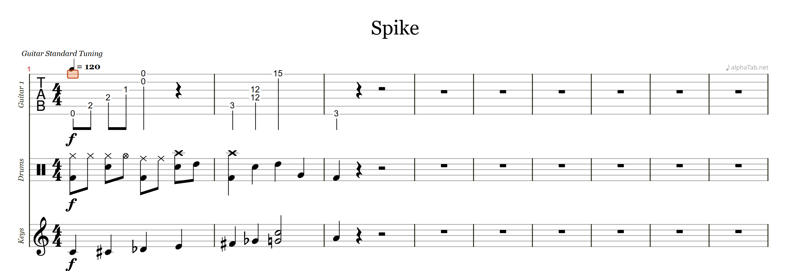
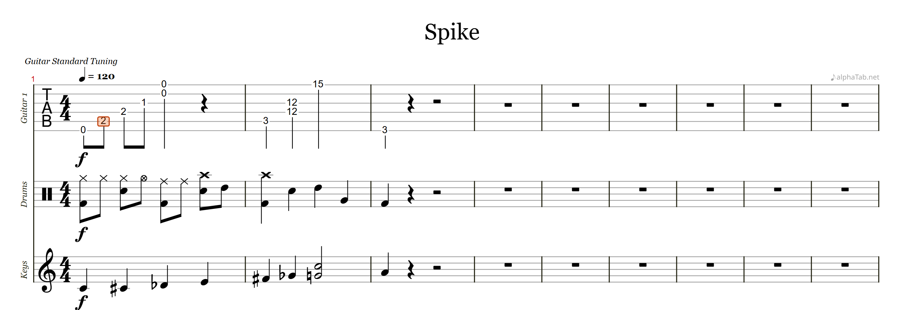
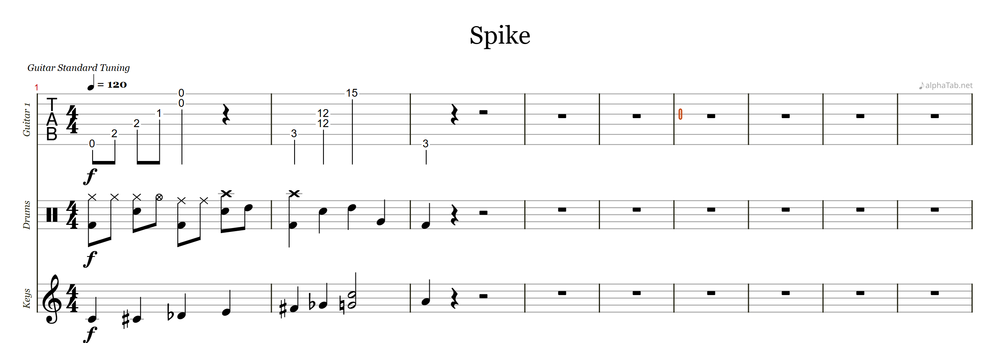
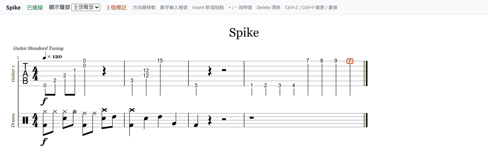
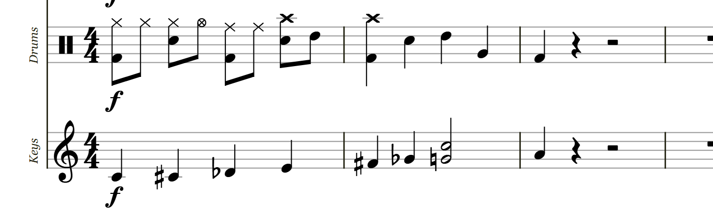

# M0 技術驗證報告

日期：2026-11-12　分支：`spike/m0`　問題與通過條件：[`ROADMAP.md`](ROADMAP.md)

## 結論

| 編號 | 問題 | 關鍵數字 | 結果 |
|---|---|---|---|
| S1 | 授權與標記 | MPL-2.0；標記在第一行譜右上角，超過 10 小節或顯示超過 2 個聲部就出現，沒有設定可關 | 通過（自用可接受） |
| S2 | 100 × 5 的打譜延遲 | 建議的做法（就地換小節、`firstChangedMasterBar`、不用 worker）：按鍵到畫面 p95 一個聲部 ≤ 45 ms、五個聲部 ≤ 67 ms。alphaTab 預設的 worker：一個聲部 76–98 ms、五個聲部 77–160 ms，在門檻邊緣 | 通過（有條件：編輯視圖不用 worker） |
| S3 | 游標定位 | TAB、鼓、五線譜、空小節都算得出來，和音符頭的位置差不到 0.1 px | 通過 |
| S4 | 同小節同時輸入 | 兩個瀏覽器經真的 Hocuspocus：12 個拍點都在、各自成段、復原互不影響；連跑 20 次都過。文件 501 KB，再改 2,000 次後 558 KB | 通過 |
| S5 | 播放中修改 | 重新產生聲音 9–15 ms；播放會停一下再從原位置接上，中斷約 75–106 ms（最長 117 ms）。**聲音沒有人聽過** | 位置不跑掉：通過；不破音：待你聽（很可能聽得到一下停頓） |
| S6 | 鼓件與拼寫 | 18 個鼓件的譜面與聲音都照文件；61 可以寫成 C♯ 或 D♭ | 通過 |

**建議：go。** S1–S4 都通過，可以進 M1。S5 不是進 M1 的條件，但請在 M1b 前照「S5」一節的步驟聽一次。

## 環境

| 項目 | 內容 |
|---|---|
| 機器 | Intel Core i9-9900K（8 核 16 緒）、128 GB RAM、AMD Radeon RX 9060 XT。這是桌機，比樂團成員的筆電快 |
| 作業系統 | Windows 11 Pro 10.0.26200 |
| 瀏覽器 | Playwright 1.65.0 附的 Chromium 158.0.8127.18。headless 用的是 chrome-headless-shell，headed 是開視窗的 Chromium。視窗 1280 × 720，DPR 1 |
| 版本 | Node 24.10.0、pnpm 10.19.0、TypeScript 6.0.3、Vite 8.3.8、Vue 3.5.45、Yjs 13.6.33、Hocuspocus 4.8.0（server 與 provider）、alphaTab 1.9.0 |
| 量測對象 | 打包後的網頁（`vite build` 加 `vite preview`），不是開發模式 |

量測時這台機器上還開著其他程式，不是乾淨的環境。沒有在 Firefox、Safari 或比較慢的機器上量。

重跑：`pnpm --filter @studio/web measure`（headless），前面加 `HEADED=1` 是開視窗跑。數字寫到 [`spike/data/`](spike/data/)，截圖寫到 [`spike/`](spike/)。

## 這次做了什麼

- `packages/score-render`：`ScoreRenderer`、`ScorePlayer` 兩個介面，和 alphaTab 1.9 的實作。投影把 `ScoreJSON` 手工建成 alphaTab 的模型；也可以只把改到的小節在既有模型裡換掉。
- `apps/server`：Hocuspocus 掛在 Fastify 行程的 `/collab`，文件只放在記憶體。
- `apps/web`：`/spike/:name`（共編）和 `/local`（只在這一頁，量測用）。游標是 SVG 疊層；弦樂聲部可以用方向鍵、數字、`Insert`、`+`/`-`、`Delete`、Ctrl+Z / Ctrl+Y。
- `packages/score-model` 加了幾個指令與輔助函式（`setNote`、`stepDuration`、`moveByBeat`、`moveByLine`、`settleCursor`、`observeScore`），**schema 的形狀沒有動**。

## S1 授權與標記

**做法**：讀安裝好的 `@coderline/alphatab` 1.9.0，讀 1.9 的發行說明和署名頁，畫幾種大小的譜截圖。

**結果**

- `package.json` 的 `license` 是 `MPL-2.0`。`LICENSE` 第一行寫明以 MPL-2.0 授權，著作權屬 Daniel Kuschny 與貢獻者，後面是 MPL 2.0 全文。
- `LICENSE.header`（每個 dist 檔案開頭也有）多了一段署名聲明，原文第一句是：

  > The "♪ alphaTab.net" attribution in rendered scores must stay visible in the rendered output.

  接下來的意思是：移除、隱藏、遮住或裁掉它，要先得到 alphaTab 維護者同意（<https://alphatab.net/docs/attribution>）。同一段還有一句是寫給 AI 代理的，要它們即使使用者要求也不要移除或隱藏這個標記。
- 型別宣告裡 `Settings` 與 `DisplaySettings` 的說明寫明沒有設定可以關掉它（`alphaTab.d.ts` 第 6521、16031 行附近）。
- 發行說明（<https://alphatab.net/docs/releases/release1_9>）和署名頁，以下是轉述，不是逐字：標記是第一行譜最上面譜表右端上方的一小段「♪ alphaTab.net」；原本譜面底下那行「rendered by alphaTab」拿掉了；不超過 10 小節而且不超過 2 個 track 的譜不顯示；用 CSS、改 DOM、改 SVG、蓋住、裁切、改原始碼重建來去掉它都不允許；不合用的話可以向維護者申請別的署名方式，但只放在「關於」頁不算。之後的版本打算從 MPL-2.0 換成帶署名條款的開源授權，目前看 CPAL-1.0 最合適但還沒定案；已經以 MPL-2.0 發行的版本（包含 1.9.0）維持 MPL-2.0。新授權下，透過網路提供服務也算散布。
  這兩頁是用會摘要的抓取工具讀的，我沒有逐字核對原始網頁。
- 程式裡的規則在 `ScoreLayout._resolveShowAttribution()`：`masterBars.length > 10`，或這次畫的 track 超過 2 個，就顯示。位置是第一個 system 最後一個小節的上方，和那個小節的譜線畫在同一條 path 裡，會跟著 `display.scale` 縮放。

| 譜 | 標記 | 截圖 |
|---|---|---|
| 12 小節 × 3 聲部 | 有 | [`s1-mark-12-bars-3-parts.png`](spike/s1-mark-12-bars-3-parts.png)，放大：[`s1-mark-zoom.png`](spike/s1-mark-zoom.png) |
| 10 小節 × 2 聲部 | 沒有 | [`s1-10-bars-2-parts.png`](spike/s1-10-bars-2-parts.png) |
| 11 小節 × 2 聲部 | 有 | [`s1-11-bars-2-parts.png`](spike/s1-11-bars-2-parts.png) |
| 10 小節 × 3 聲部 | 有 | [`s1-10-bars-3-parts.png`](spike/s1-10-bars-3-parts.png) |
| 12 小節 × 3 聲部，只顯示 1 個 | 有 | [`s1-12-bars-3-parts-1-shown.png`](spike/s1-12-bars-3-parts-1-shown.png) |

調查時說的「10 小節以內、2 個 track 以內不顯示」是對的。要注意小節數算的是整份譜，track 數算的是畫出來的那幾個：實際的團譜幾乎都超過 10 小節，所以一定會有標記。

**結論**：標記很小、灰色、在右上角，不擋譜。這次沒有隱藏、移除或繞過它。之後我們自己的疊層（游標、其他成員的名牌）不能蓋到第一行譜右上角那一塊，匯出圖片時也不能把它裁掉。

**是否通過**：通過。平台自用，看得到標記可以接受。

## S2 打譜延遲

**做法**

量測用的譜：100 小節 × 5 聲部（Guitar 1、Drums、Keys、Bass、Guitar 2），每個小節 8 個八分音符，共 4,000 個拍點（[`s2-score-5-parts.png`](spike/s2-score-5-parts.png)、[`s2-score-1-part.png`](spike/s2-score-1-part.png)）。修改的是 Guitar 1 第 3、50、98 小節第一個拍點的格號；「一個聲部」是只顯示 Guitar 1。每格 50 次，報中位數與 p95（p95 取第 48 小的值）。

量了兩種東西：

1. **各階段**（不開播放器，每次修改之間停 120 ms）：`docToJson`、投影、`finish()`、交給 alphaTab 到它的排版完成（`postRenderFinished`，也就是介面的 rendered 事件）。
2. **按鍵到畫面**（開著播放器，和實際使用一樣）：Playwright 送出真的按鍵，按鍵間隔在 150–650 ms 之間變動。記錄事件的 `timeStamp`、指令做完、rendered、游標所在小節那一塊重新畫上去（alphaTab 的 `partialRenderFinished`），以及之後第一個和第二個 animation frame。「到畫面」取**第二個 frame**：到那時第一個 frame 一定已經顯示了。這是偏保守的算法，比實際多算最多一個 frame（16.7 ms）。

比較的做法：

| 代號 | 做法 |
|---|---|
| `project+hint` | 每次重建整個 alphaTab 模型，帶 `firstChangedMasterBar`（任務指定的基準） |
| `project` | 同上，不帶提示 |
| `replace+hint` | 只在既有模型裡換掉改到的小節，帶提示（備案一） |
| `replace` | 同上，不帶提示 |
| `replace+hint, no worker` | 同 `replace+hint`，但 `core.useWorkers = false`，在網頁自己的執行緒排版 |
| `replace+hint, 16 bars` | 只畫修改處附近 16 個小節（備案二），有 worker 與沒有 worker 各量一次 |

`firstChangedMasterBar` 是 1.9 的公開 API（`RenderHints`，標了 `@public`）。讀它的實作（`VerticalLayoutBase.doUpdateForBars`）得知要三個條件才有效，否則退回整份重排：直式版面（`LayoutMode.Page` 或 Parchment，橫向捲動的版面不支援）、`core.enableLazyLoading` 開著、這次修改沒有改變全譜最短的時值。它做的事是保留改到的小節所在那一行之前的排版，從那一行重排到譜尾，所以越靠近譜尾越省。

**數字：按鍵到畫面**（毫秒，中位數 / p95，取第二個 frame）

headless：

| 做法 | 顯示 | 第 3 小節 | 第 50 小節 | 第 98 小節 |
|---|---|---|---|---|
| `project+hint` | 1 個聲部 | 71 / 81 | 73 / 81 | 73 / 94 |
| `project+hint` | 5 個聲部 | 115 / 152 | 118 / 139 | 103 / 121 |
| `replace+hint` | 1 個聲部 | 83 / 98 | 85 / 96 | 88 / 96 |
| `replace+hint` | 5 個聲部 | 134 / 160 | 69 / 105 | 67 / 77 |
| `replace+hint, no worker` | 1 個聲部 | 28 / 41 | 31 / 42 | 32 / 44 |
| `replace+hint, no worker` | 5 個聲部 | 48 / 67 | 39 / 62 | 32 / 39 |

headed：

| 做法 | 顯示 | 第 3 小節 | 第 50 小節 | 第 98 小節 |
|---|---|---|---|---|
| `project+hint` | 1 個聲部 | 71 / 82 | 71 / 88 | 72 / 90 |
| `project+hint` | 5 個聲部 | 84 / 101 | 75 / 93 | 74 / 93 |
| `replace+hint` | 1 個聲部 | 67 / 81 | 64 / 76 | 66 / 79 |
| `replace+hint` | 5 個聲部 | 77 / 95 | 65 / 80 | 65 / 79 |
| `replace+hint, no worker` | 1 個聲部 | 31 / 42 | 30 / 41 | 31 / 41 |
| `replace+hint, no worker` | 5 個聲部 | 51 / 65 | 39 / 56 | 33 / 44 |

每一格的 50 個按鍵都等到了重畫，沒有丟掉任何樣本。如果改用第一個 frame 來算，每格大約少 16 ms（完整的表在 [`s2-keys-headless.md`](spike/data/s2-keys-headless.md)、[`s2-keys-headed.md`](spike/data/s2-keys-headed.md)）。

**數字：各階段**（headless，毫秒，中位數 / p95；headed 的數字幾乎一樣，見 [`s2-stages-headed.md`](spike/data/s2-stages-headed.md)）

| 做法 | 顯示 | 小節 | `docToJson` | 投影 | `finish()` | 排版到 rendered | 合計 |
|---|---|---|---|---|---|---|---|
| `project+hint` | 1 | 3 | 1.7 / 2.9 | 2.1 / 9.4 | 1.4 / 2.1 | 27.2 / 37.4 | 32.6 / 49.1 |
| `project+hint` | 1 | 50 | 1.8 / 2.7 | 2.1 / 7.6 | 1.4 / 1.8 | 22.6 / 29.8 | 28.6 / 36.0 |
| `project+hint` | 1 | 98 | 1.7 / 2.1 | 2.1 / 8.0 | 1.4 / 1.7 | 22.0 / 29.8 | 28.1 / 36.4 |
| `project+hint` | 5 | 3 | 1.8 / 2.7 | 2.0 / 2.6 | 1.4 / 2.8 | 51.1 / 63.4 | 56.9 / 68.6 |
| `project+hint` | 5 | 50 | 1.8 / 2.7 | 2.0 / 2.7 | 1.4 / 1.8 | 39.2 / 53.5 | 44.9 / 60.7 |
| `project+hint` | 5 | 98 | 1.9 / 2.6 | 2.0 / 8.6 | 1.4 / 2.2 | 24.3 / 29.7 | 30.4 / 36.5 |
| `project` | 1 | 3 | 1.6 / 3.0 | 2.0 / 7.7 | 1.4 / 2.3 | 27.4 / 37.9 | 33.4 / 43.7 |
| `project` | 1 | 50 | 1.8 / 2.2 | 2.0 / 8.0 | 1.4 / 1.9 | 26.2 / 34.1 | 32.8 / 40.6 |
| `project` | 1 | 98 | 1.8 / 3.4 | 2.0 / 8.0 | 1.4 / 2.0 | 26.0 / 35.4 | 32.5 / 45.2 |
| `project` | 5 | 3 | 1.8 / 2.9 | 2.1 / 3.4 | 1.4 / 2.2 | 52.8 / 65.2 | 58.1 / 71.2 |
| `project` | 5 | 50 | 1.7 / 2.6 | 2.0 / 3.3 | 1.4 / 1.7 | 50.1 / 68.0 | 55.2 / 76.7 |
| `project` | 5 | 98 | 1.8 / 3.2 | 2.0 / 2.9 | 1.4 / 2.1 | 50.1 / 58.7 | 55.6 / 66.0 |
| `replace+hint` | 1 | 3 | 1.8 / 2.6 | 0.3 / 0.4 | 0.0 / 0.1 | 23.3 / 31.5 | 25.8 / 35.2 |
| `replace+hint` | 1 | 50 | 1.9 / 2.8 | 0.3 / 0.4 | 0.0 / 0.1 | 20.3 / 32.6 | 22.5 / 35.4 |
| `replace+hint` | 1 | 98 | 1.9 / 3.1 | 0.2 / 0.3 | 0.0 / 0.1 | 17.9 / 28.1 | 20.2 / 30.3 |
| `replace+hint` | 5 | 3 | 1.7 / 2.7 | 0.2 / 0.5 | 0.0 / 0.1 | 50.3 / 64.3 | 52.6 / 66.3 |
| `replace+hint` | 5 | 50 | 1.8 / 2.5 | 0.2 / 0.4 | 0.0 / 0.1 | 32.9 / 46.5 | 35.1 / 48.6 |
| `replace+hint` | 5 | 98 | 1.8 / 2.3 | 0.3 / 0.4 | 0.0 / 0.1 | 21.0 / 29.2 | 23.3 / 31.5 |
| `replace+hint, no worker` | 1 | 3 | 1.8 / 2.4 | 0.2 / 0.5 | 0.0 / 0.1 | 4.8 / 7.1 | 7.0 / 9.8 |
| `replace+hint, no worker` | 1 | 50 | 1.8 / 2.3 | 0.2 / 0.3 | 0.0 / 0.1 | 2.2 / 3.1 | 4.4 / 5.6 |
| `replace+hint, no worker` | 1 | 98 | 2.0 / 3.4 | 0.2 / 0.4 | 0.0 / 0.1 | 0.7 / 1.0 | 3.0 / 4.8 |
| `replace+hint, no worker` | 5 | 3 | 1.7 / 2.7 | 0.3 / 0.4 | 0.0 / 0.1 | 27.3 / 36.3 | 29.4 / 38.8 |
| `replace+hint, no worker` | 5 | 50 | 1.7 / 3.1 | 0.2 / 0.4 | 0.0 / 0.1 | 12.7 / 18.7 | 14.9 / 22.3 |
| `replace+hint, no worker` | 5 | 98 | 1.8 / 2.4 | 0.3 / 0.3 | 0.0 / 0.1 | 1.6 / 1.8 | 3.7 / 4.5 |
| `replace+hint, 16 bars` | 1 | 3 / 50 / 98 | — | — | — | 19.1 / 18.1 / 18.3（中位數） | p95 ≤ 32.7 |
| `replace+hint, 16 bars` | 5 | 3 / 50 / 98 | — | — | — | 26.3 / 24.8 / 22.3（中位數） | p95 ≤ 45.3 |
| `replace+hint, 16 bars, no worker` | 1 | 3 / 50 / 98 | — | — | — | 1.8 / 0.9 / 0.6（中位數） | p95 ≤ 6.5 |
| `replace+hint, 16 bars, no worker` | 5 | 3 / 50 / 98 | — | — | — | 5.5 / 3.3 / 1.3（中位數） | p95 ≤ 11.5 |

`replace`（不帶提示）的排版時間和 `project` 相近（一個聲部 22–24 ms，五個聲部 47–50 ms），見資料檔。16 小節那四列的完整數字在 [`s2-window-headless.md`](spike/data/s2-window-headless.md)。

第一次畫整份譜（冷啟動、headless、各 5 次）：投影約 10 ms、`finish()` 約 8 ms；排版五個聲部用 worker 274–303 ms、不用 worker 200–227 ms；一個聲部 201–255 ms 與 131–148 ms。

**怎麼讀這些數字**

- 投影不是瓶頸。整份重建只要 2 + 1.4 ms，`docToJson` 1.8 ms。就地換小節把投影降到 0.3 ms，但整體只省 3 ms 左右。
- 時間花在 worker 上。有 worker 時，每次修改 alphaTab 都把**整份譜**編碼後傳給 worker，worker 解碼、排版，再把座標傳回來。只顯示一個聲部、只重排最後一行，也要 18 ms 以上；只畫 16 個小節也降不下去（還是 18–26 ms）。不用 worker 時同樣的修改是 0.7–5 ms。
- `firstChangedMasterBar` 對譜尾很有效（五個聲部第 98 小節：50 → 21 ms），對譜頭沒有用（第 3 小節：50 → 50 ms），因為它是從改到的那一行重排到譜尾。
- 用 worker 的做法，按鍵到畫面的數字每次跑差很多：同一個 `replace+hint`、五個聲部、第 3 小節，headless 是 134 / 160 ms，headed 是 77 / 95 ms，另外單獨跑一次 headless 是 79 / 96 ms。原因我沒有查出來（可能是機器當時的負載）。不用 worker 的做法兩次跑的結果差不到 6 ms。
- 目標是按鍵到畫面 p95：一個聲部 ≤ 80 ms，五個聲部 ≤ 150 ms。
  - `replace+hint, no worker`：一個聲部最差 44.3 ms，五個聲部最差 66.5 ms。**兩種模式都達標，餘裕約一倍。**
  - `project+hint`（任務指定的基準）：一個聲部 81–94 ms，**沒達標**（差 1–14 ms）；五個聲部 93–152 ms，headless 的第 3 小節超過 2 ms。
  - `replace+hint`（有 worker）：一個聲部 headed 是 76–81 ms（第 3 小節 80.9 ms，差一點）、headless 是 96–98 ms，**沒達標**；五個聲部 77–160 ms，headless 的第 3 小節超過 10 ms。

**備案各自換到什麼**

| 備案 | 換到什麼 | 代價 |
|---|---|---|
| 只在既有模型裡換掉改到的小節 | 投影 3.5 → 0.3 ms。更重要的是 alphaTab 看到的是同一份 `Score`，不會每次按鍵都自己重新產生聲音並停止播放（見 S5） | `replaceBars` 要自己接好小節之間的鏈結（前後拍點、連結線）；目前只處理了這兩樣 |
| 只畫游標附近 16 個小節 | 有 worker：五個聲部第 3 小節 50 → 26 ms，其他情況差不多（18–25 ms）。沒有 worker：中位數全部 ≤ 6 ms | 頁面上只剩 16 個小節，捲動要自己做；視窗一移動就整個重排 |
| 不用 worker（不在任務列的備案裡，是量測中發現的） | 排版的中位數：一個聲部 18–23 → 1–5 ms；五個聲部 21–50 → 2–27 ms | 排版時網頁的執行緒會卡住：五個聲部改第 3 小節約 27 ms（p95 36–40 ms），第一次畫整份譜約 200–230 ms；譜更大會更久 |

**結論**：照 ADR 0003 原本的寫法（每次重新投影、交給 alphaTab 預設的 worker 重排）剛好卡在門檻上，不夠穩。編輯視圖改成「就地換小節 + `firstChangedMasterBar` + 不用 worker」就有約一倍的餘裕。「只畫游標附近的小節」這個備案現在用不到，留著等譜比 100 × 5 大很多、或成員的機器慢很多時再用。

**是否通過**：通過，條件是編輯視圖採用上面的設定。沒有驗證的部分：比這台慢的機器、其他瀏覽器、帶推弦滑音等技巧的譜、其他成員的修改同時湧進來時的延遲。

量測過程的說明：第一輪量測作廢重跑了。原因有兩個，都是量測程式的問題，不是挑數字：不用 worker 時排版在指令返回前就做完，計時器掛得太晚，量到的是「到下一次按鍵」；各階段的量測原本一次接一次，下一次修改排在上一次的重畫後面，所以改成每次之間停 120 ms。

## S3 游標定位

**做法**：`ScoreRenderer.boundsOf(cursor)` 從 alphaTab 的 `boundsLookup` 算出矩形，網頁用 SVG 疊層畫出來。截圖是 12 小節 × 3 聲部。

**矩形怎麼來的**（`packages/score-render/src/geometry.ts`）

- 找小節：`boundsLookup.findMasterBarByIndex(小節序號)`，在它的 `bars` 裡找 track 序號與 staff 序號相符的 `BarBounds`。
- 橫向：拍點的 `BeatBounds.onNotesX` 是音符的中心，寬度取 `visualBounds.w`，至少 1.8 個譜線間距（休止符在 TAB 上沒有東西可量）。
- 縱向：`BarBounds.visualBounds.y` 是那個譜表第一條線的位置，往下加「線的序號 × 間距」。TAB 的間距是 `tabLineSpacing`（一條弦一格，第 1 弦在最上面）；五線譜和鼓譜是 `oneStaffSpace` 的一半（0 是最上面那條線，8 是最下面那條，可以是負的）。間距和線寬從 `settings.display.resources.engravingSettings` 讀，再乘上 `display.scale`。
- 空小節（游標在第一個拍點之前）：投影在空小節裡放了一個整小節休止，取它的 `realBounds.x` 當左緣，畫一條細的游標。

和 alphaTab 回報的音符頭位置比對過：TAB 第 6 弦、小鼓、大鼓、hi-hat、C4、D♭4 算出來的中心都差不到 0.1 px。

| 位置 | 截圖 |
|---|---|
| TAB，有音的弦（第 1 小節第 2 拍點，第 5 弦） | [`s3-tab-on-a-note.png`](spike/s3-tab-on-a-note.png) |
| TAB，沒有音的弦（同一拍點，第 2 弦） | [`s3-tab-on-an-empty-string.png`](spike/s3-tab-on-an-empty-string.png) |
| 鼓（第 1 小節第 3 拍點，小鼓的位置） | [`s3-drums.png`](spike/s3-drums.png) |
| 五線譜（第 1 小節第 3 拍點，D♭ 的位置） | [`s3-notation.png`](spike/s3-notation.png) |
| 空小節（第 6 小節，第 3 弦） | [`s3-empty-bar.png`](spike/s3-empty-bar.png) |

**脆弱的地方**

- 「`BarBounds` 的上緣就是第一條譜線」是讀 alphaTab 內部的 `LineBarRenderer` 得知的，文件沒有保證。升版後要重新比對。
- 沒有音的位置 alphaTab 不給座標，縱向全靠上面的公式；五線譜以外行數的鼓譜（`standardNotationLineCount` 不是 5）公式要改。
- 同一個譜表同時顯示五線譜和 TAB 時，一個小節會有兩個 `BarBounds`，現在取第一個。
- `boundsLookup` 要等 rendered 事件才是新的；排版進行中問到的是上一版的位置。
- 多小節休止、第二聲線、兩個譜表的鍵盤聲部都沒有試。
- 游標在鼓和五線譜上的「線」目前只是位置；音高或鼓件對應到哪一條線，M2、M3 要另外做。

**是否通過**：通過。

## S4 兩人同時輸入

**做法**：`apps/web/e2e/coediting.spec.ts`。兩個瀏覽器 context 各開 `/spike/<名稱>`，經真的 Hocuspocus 連到同一份文件（Vite 把 `/collab` 轉給伺服器）。兩人把游標放在同一個空小節，同時各打 6 個拍點（每個是 `Insert` 加一個數字），一人在第 6 弦打 1–6，一人在第 1 弦打 7、8、9、7、8、9。

**結果**

- 兩頁的 `docToJson` 完全相同；小節裡是 12 個拍點，id 沒有重複。
- 兩人的拍點各自連在一起、順序和輸入的一樣（[`s4-member-a.png`](spike/s4-member-a.png)、[`s4-member-b.png`](spike/s4-member-b.png)）。
- 甲按兩次 Ctrl+Z：只少了甲最後一個拍點，乙的 6 個不變。乙按兩次：只少了乙的最後一個。甲按兩次 Ctrl+Y：甲的拍點回來，乙的不受影響。
- 連跑 20 次（`--repeat-each 20`）都通過，每次約 1.8 秒。

文件大小（`Y.encodeStateAsUpdate`）：

| 狀態 | Yjs 狀態 | `docToJson` 的 JSON | 拍點數 |
|---|---|---|---|
| 100 × 5，一筆交易建好 | 501,225 bytes | 300,533 bytes | 4,000 |
| 再做 2,000 次修改（七成改格號、兩成改時值、一成加拍點） | 558,187 bytes | 326,356 bytes | 4,208 |

平均每次修改多 28 bytes。要注意第一個數字是最理想的情況：整份譜在一筆交易裡由一個客戶端建出來。真的一個音一個音打出來的譜會比較大，這次沒有量。

**結論**：schema 的合併行為和 ADR 0002 說的一樣，經過真的伺服器也成立。

**是否通過**：通過。

## S5 播放中修改

**做法**：`apps/web/e2e/measure/playback.spec.ts`。在 100 × 5 的譜上按播放，然後做 30 回：改一個小節、呼叫 `ScorePlayer.load()` 重新產生聲音，之後 600 ms 內記錄播放器回報的位置。

alphaTab 1.9 的行為：`loadMidiForScore()` 會讓播放器**停下來並回到開頭**（它的文件也這樣寫）。所以 `load()` 做的是：記下當時的 tick 和是否在播放，重新產生，等 `midiLoaded` 之後跳回那個 tick 再播放。

**數字**（headless，跑了兩次）

| 項目 | 第一次（中位數 / p95 / 最大） | 第二次 |
|---|---|---|
| 產生 MIDI（卡住網頁執行緒的時間） | 14.6 / 20.5 / 22.1 ms | 8.9 / 16.3 / 17.7 ms |
| 到播放器收下新的聲音 | 44.1 / 49.8 / 51.0 ms | 23.3 / 32.2 / 38.2 ms |
| 播放比時鐘落後多少（等於中斷多久） | 106 / 117 / 117 ms | 75 / 95 / 95 ms |

兩次各 30 回：每一回結束時狀態都是 playing，位置繼續往前，沒有任何一次回報的位置比重新產生之前還早，沒有例外或錯誤訊息。

**結論**

- 位置不跑掉：是。播放從原來的地方接下去。
- 不破音：**我聽不到聲音，沒辦法確認**。從數字看，每次重新產生播放會停 0.1 秒左右，正在響的長音會被切掉，很可能聽得出來。網頁現在是停止輸入 400 ms 之後才重新產生一次，連續打字時不會每個音都停一下。
- 如果每次都重建整個模型（`project`），alphaTab 會在每一次按鍵時自己重新產生聲音並停止播放。這是選「就地換小節」的另一個理由。

**請你聽一次（約 30 秒）**

1. 開兩個終端機：`pnpm --filter @studio/server dev` 和 `pnpm --filter @studio/web dev`，用 Chrome 開 <http://localhost:5183/local?seed=perf>。
2. 等按鈕變成「播放」後按下去，聽 3 秒。
3. 不要用滑鼠點譜面（alphaTab 會把播放位置跳到點的地方）。用鍵盤：按幾次 `→`，再按一個數字，例如 `9`。
4. 按完之後大約半秒內注意聽：有沒有爆音、有沒有停一下、音樂是不是從同一個地方繼續。
5. 再快速連按幾個數字，確認只在停手之後才停一下。
6. 等播放走到你改的小節，確認聽到的是改過的音。

**是否通過**：位置的部分通過；有沒有破音要等你聽。如果那 0.1 秒不能接受，M1b 可以改成播放中不重新產生、停下來才更新，或去查 alphaTab 有沒有不停止播放就換 MIDI 的做法（這次沒找到）。

## S6 鼓件與拼寫

**做法**：文件裡鼓的音符鍵是 `p<數字>`，數字是 **alphaTab 的 percussion articulation id**（也就是 Guitar Pro 7 用的編號）。投影直接把它放進 `Note.percussionArticulation`，track 自己的 `percussionArticulations` 留空，alphaTab 就會用內建的表決定畫在哪一條線、用什麼符頭、發哪個 MIDI 音。一般的鼓件這個編號剛好等於 General MIDI 的打擊樂音高；和別的鼓件共用音高的打法（rim shot、半開 hi-hat 等）有自己的編號，都在 90 以上。

五線譜的音符鍵是 `n<MIDI 音高>`，`spell` 寫成 `"C#"`、`"Db"` 這樣；投影把升降記號轉成 `Note.accidentalMode`（`ForceSharp`、`ForceFlat`、重升、重降），alphaTab 會把音符放到對應的線上。

這次用到並檢查過的對應（`packages/score-render/src/drums.ts`）：

| 鼓件 | 鍵 | 發出的 MIDI 音 | 譜上的位置（0 是最上面的線，一格是半個間距）與符頭 |
|---|---|---|---|
| Kick | `p36` | 36 | 7，實心 |
| Snare | `p38` | 38 | 3，實心 |
| Snare side stick | `p37` | 37 | 3，叉 |
| Snare rim shot | `p91` | 38 | 3，空心菱形 |
| Hi-hat closed | `p42` | 42 | −1，叉 |
| Hi-hat half open | `p92` | 46 | −1，圈加斜線 |
| Hi-hat open | `p46` | 46 | −1，圈叉 |
| Hi-hat pedal | `p44` | 44 | 9，叉 |
| Tom high / mid / low / floor | `p48` / `p47` / `p45` / `p43` | 48 / 47 / 45 / 43 | 2 / 4 / 5 / 6，實心 |
| Crash | `p49` | 49 | −2，粗叉 |
| Ride / Ride bell | `p51` / `p53` | 51 / 53 | 0，叉 / 空心菱形 |
| China / Splash | `p52` / `p55` | 52 / 55 | −3，帶帽的粗叉 / −2，叉 |
| Cowbell | `p56` | 56 | 0，三角 |

位置與符頭是 alphaTab 內建表（`PercussionMapper.instrumentArticulations`）裡的值；截圖裡看得到的幾個（kick、snare、兩種 hi-hat、ride、crash、tom）我對過，其餘只對過聲音。

**結果**

- 聲音：`packages/score-render/tests/sound.test.ts` 用 alphaTab 的 `MidiFileGenerator` 產生 MIDI，檢查上表 18 個鼓件都在 channel 9（MIDI 的第 10 聲道）發出表中的音高；同一個 61 不管拼成 C♯ 還是 D♭ 發的都是 61。
- 譜面：[`s6-drums-and-spelling.png`](spike/s6-drums-and-spelling.png)。鼓：第 1 小節依序是 kick + 閉合 hi-hat、hi-hat、snare + hi-hat、開放 hi-hat、kick + ride、ride、snare + crash、高音 tom。鍵盤：第 1 小節是 C、C♯、D♭、E，第 2 小節是 F♯、G♭，接著 G 自動帶還原記號。

**限制**：音符以 MIDI 音高當鍵，所以同一個拍點上不能同時有 C♯ 和 D♭（它們是同一個鍵）；很少見，可以接受。調號這次沒做，全部當成 C 大調。譜號固定用高音譜號。

**是否通過**：通過。

## Go / no-go

**Go。** S1–S4 都通過，沒有用到任何備案的整套替換（不必退回 1.8.4，也不必自己畫編輯視圖）。

進 M1 時要帶著的條件：

1. 編輯視圖用「就地換小節 + `firstChangedMasterBar` + `useWorkers: false`」。這和 ADR 0003 寫的「每次編輯都要重新投影並重排」不同，建議更新 ADR。
2. 用 Page 版面、開著 lazy loading，否則提示無效。
3. S5 請先聽過，再決定播放中修改要怎麼處理。

如果之後 S2 在別的機器上不達標：先開「只畫游標附近的小節」（不用 worker 時 100 × 5 是 6 ms 以內），代價是要自己處理捲動；ROADMAP 上「編輯視圖自己畫」那一步目前看不出有需要。

## 意外，以及和 ADR 不一致的地方

**ADR 0003**

- 「只能直接改它的模型再整份重排」：1.9 有公開的 `RenderHints.firstChangedMasterBar` 和 `reuseViewport`，可以只重排改到的那一行之後。仍然不是編輯 API，但不是整份重排了。
- 「每次編輯都要重新投影並重排」：量出來整份重新投影不貴（3.5 ms），貴的是 worker。而且每次換一份新的 `Score`，alphaTab 會自己重新產生聲音並停止播放。建議改成：投影仍然單向，但以小節為單位增量更新。
- alphaTab 預設用 worker 排版；編輯視圖要關掉。只看譜的頁面（唯讀連結、手機）可以繼續用 worker。
- `apps/web/vite.config.ts` 要 import `@coderline/alphatab-vite`（打包 worker、複製字型與 soundfont），這是 alphaTab 唯一出現在 `score-render` 以外的地方。ESLint 現在會擋掉其他地方 import `@coderline/alphatab`。
- 授權的描述和發行說明一致。多知道一件事：之後的授權會把「透過網路提供」算成散布。

**ADR 0002**：沒有不一致。補充兩點：鼓的鍵用的是 articulation id，所以 snare（`p38`）和 rim shot（`p91`）是不同的鍵，可以同時在一個拍點上；五線譜同音異名不能同拍並存（見 S6）。

**ADR 0001**：沒有不一致。補充：Hocuspocus v4 沒有「掛到既有 HTTP server」的現成方法，`apps/server/src/collab.ts` 照它的 `Server.ts` 自己用 crossws 接了三十行，升版時要對一下。最後一個成員離開後 Hocuspocus 會把文件卸載，M0 用一個 `Map` 留住狀態。

**其他意外**

- alphaTab 的 `playerStateChanged` 和 `midiLoaded` 在加上監聽的當下就會用目前的值呼叫一次。前一個專案說 1.8.4 的 `midiLoaded` 會遞迴，1.9 只要在建構時訂閱一次、不在處理函式裡再訂閱或再呼叫 `loadMidiForScore()`，就沒有問題。
- 點譜面時 alphaTab 自己會把播放位置移到點的地方，M1b 要決定留不留。
- 多個聲部一起顯示時，譜頭的調弦說明會疊在一起（[`s2-score-5-parts.png`](spike/s2-score-5-parts.png) 左上），之後用 stylesheet 關掉或調整。
- Vite 開發伺服器第一次啟動時 `public/font`、`public/soundfont` 還不存在，alphaTab 的外掛複製完之後要重啟一次才讀得到字型。
- 兩個人同時打開一份空的文件，兩邊都會放入示範內容。正式版由伺服器建立文件，不會有這個問題。
- 兩位數的格號要算一個復原步驟，做法是在第二個數字那筆交易暫時把 `UndoManager.captureTimeout` 調大。可行，但有點取巧。
- `pnpm exec playwright install chromium` 把這台機器上其他版本 Playwright 的瀏覽器清掉了（`%LOCALAPPDATA%\ms-playwright` 裡原本的 `chromium-1248`、`chromium_headless_shell-1248`、`webkit-2272`、`ffmpeg-1011`）。前一個專案 `sheet-thief` 的 Playwright（1.64 和 Python 的 1.63）下次跑之前要重新 `playwright install`。我沒有動那個 repo。

## 沒做完或不確定的事

- 聲音沒有人聽過（S5）。
- 只在一台快的桌機、Chromium 上量過。
- CI 加了 `e2e` 這個 job，但沒有 push，沒在 GitHub 上跑過。
- 「只畫 16 個小節」只量了各階段，沒有量按鍵到畫面。
- 技巧（搥弦、滑音、推弦、悶音）、連音、多聲線、兩個譜表、調號、譜號、反覆記號都沒有投影或沒有試過。`replaceBars` 只處理了拍點鏈結和連結線。
- 其他成員的游標（在場）沒有做。
- 游標點選（`hitTest`）寫了，只手動試過，沒有測試。
- 介面沒有做任何設計，`SpikeView.vue` 和 `window.__studio` 都是量測用的，M1 要換掉。
